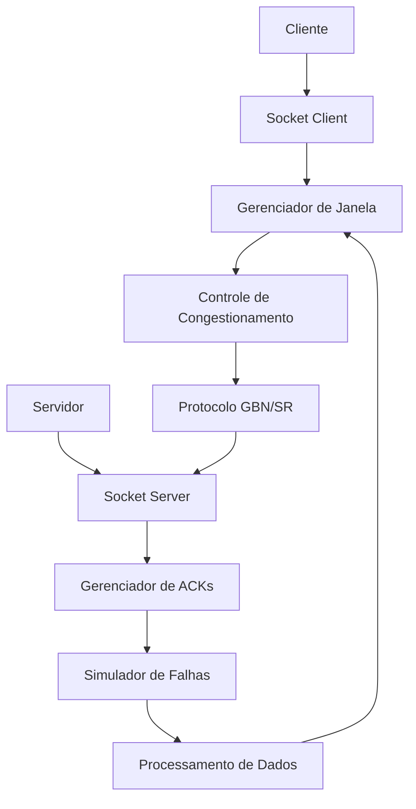
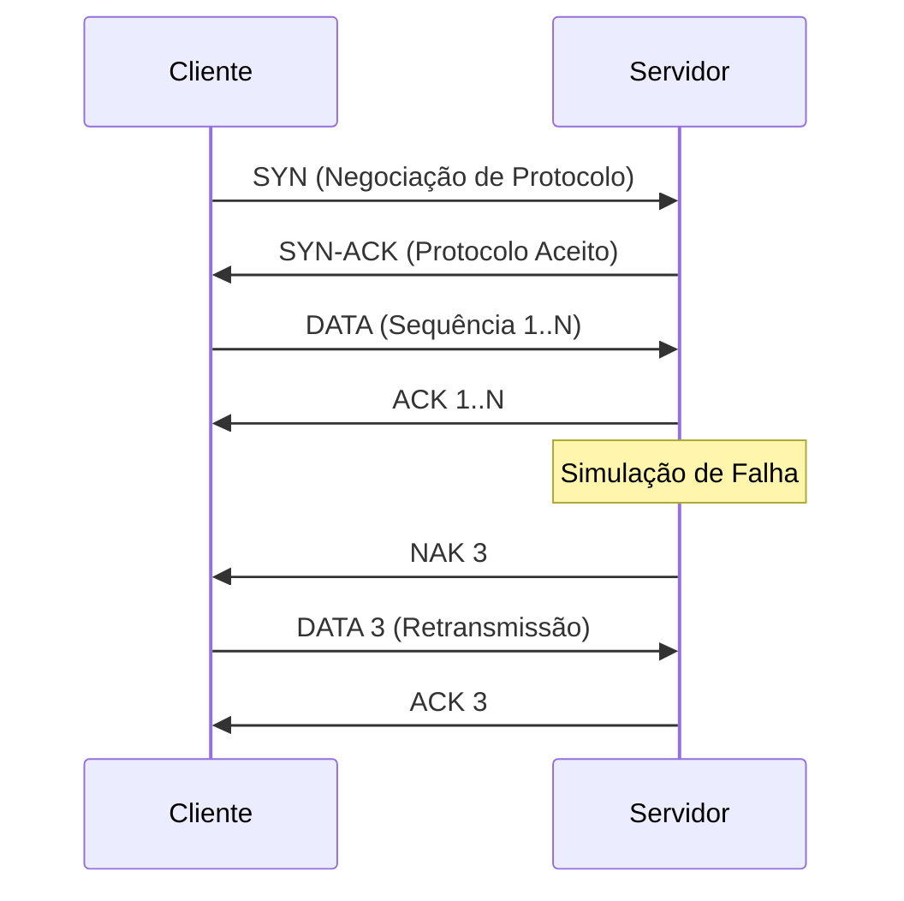

<div align="center">

# 🔌 Sistema de Comunicação Cliente-Servidor com Controle de Congestionamento


<p align="center">
  
  
  
  
</p>


</div>

## 📋 Descrição do Projeto

Este projeto implementa um sistema **cliente-servidor** avançado para transporte confiável de dados em ambientes com perdas de pacotes e erros simulados. Desenvolvido com sockets Python, o sistema incorpora mecanismos sofisticados de **controle de fluxo** e **controle de congestionamento**, garantindo a entrega e integridade dos dados mesmo em condições adversas.

### 🎯 Objetivos Principais
- 🔒 **Confiabilidade**: Garantir entrega ordenada e sem erros dos dados
- 📡 **Resiliência**: Operar eficientemente em ambientes com perdas de pacotes
- ⚡ **Eficiência**: Otimizar utilização da rede através de controle de congestionamento
- 🧪 **Testabilidade**: Permitir simulação e análise de diferentes cenários de falha

---

## 🏗️ Arquitetura do Sistema

### 🔄 Protocolos Implementados

| **Protocolo** | **Descrição** | **Vantagens** | **Casos de Uso** |
|---------------|---------------|---------------|------------------|
| **Go-Back-N** | Retransmissão em lote a partir do primeiro pacote perdido | Simplicidade | Redes com baixa taxa de erro |
| **Repetição Seletiva** | Retransmissão apenas de pacotes específicos perdidos | Eficiência de banda | Redes com alta taxa de erro |

### 📡 Componentes Principais



---

## ⚙️ Funcionalidades Detalhadas

### 🖥️ Módulo Cliente

| **Funcionalidade** | **Descrição** | **Implementação** |
|-------------------|---------------|-------------------|
| **Conexão Flexível** | Suporte a localhost e endereços IP remotos | Socket TCP/IP |
| **Envio em Rajada** | Transmissão de múltiplos pacotes simultaneamente | Buffer dinâmico |
| **Injeção de Erros** | Simulação proposital de corrupção de dados | Checksum manipulado |
| **Atualização em Tempo Real** | Ajuste dinâmico da janela de recepção | Feedback contínuo |

### 🌐 Módulo Servidor

| **Funcionalidade** | **Descrição** | **Implementação** |
|-------------------|---------------|-------------------|
| **Gestão Inteligente** | Controle preciso de confirmações e negativas | State machine |
| **ACKs Seletivos** | Suporte a confirmações positivas e negativas | Protocolo customizado |
| **Negociação de Protocolo** | Escolha dinâmica entre GBN e Repetição Seletiva | Handshake inicial |
| **Janela Adaptativa** | Ajuste automático baseado em condições da rede | Algoritmo AIMD |

---

## 🎯 Protocolo de Aplicação

### 📝 Especificação Técnica

| **Campo** | **Tamanho** | **Descrição** |
|-----------|-------------|---------------|
| **Sequence Number** | 32 bits | Identificação única do pacote |
| **Checksum** | 16 bits | Verificação de integridade (CRC-16) |
| **ACK Flag** | 1 bit | Indicador de confirmação |
| **NAK Flag** | 1 bit | Indicador de confirmação negativa |
| **Window Size** | 16 bits | Tamanho atual da janela |
| **Payload** | Variável | Dados da aplicação |

### 🔄 Fluxo de Comunicação



---

## 🧪 Simulação de Falhas

### 🔧 Mecanismos de Teste

| **Tipo de Falha** | **Descrição** | **Impacto** |
|-------------------|---------------|-------------|
| **Perda de Pacotes** | Descarte aleatório de datagramas | Trigger de retransmissão |
| **Erros de Integridade** | Corrupção deliberada do checksum | Detecção e recuperação |
| **ACKs Perdidos** | Não confirmação de recebimento | Timeout e retransmissão |
| **Reordenamento** | Alteração na sequência de entrega | Reordenação no receptor |

### 🎛️ Controles de Simulação

```python
# Exemplo de configuração de falhas
simulation_config = {
    "packet_loss_rate": 0.05,      # 5% de perda
    "error_injection_rate": 0.02,  # 2% de erros
    "max_delay": 1000,             # 1 segundo máximo
    "reorder_packets": True        # Reordenamento ativo
}
```

---

## 🚀 Como Executar

### 📋 Pré-requisitos

```bash
# Verificar instalação do Python
python --version  # Python 3.8+

# Clone o repositório
git clone https://github.com/P-E-N-T-E-S/Soquetes.git
cd Soquetes
```

### 🖥️ Execução do Servidor

```bash
python servidor.py \
  --port 8080 \
  --protocol gbn \
  --window-size 10 \
  --simulate-errors
```

### 💻 Execução do Cliente

```bash
python cliente.py \
  --server localhost \
  --port 8080 \
  --file dados.txt \
  --burst-size 5
```

---

## 👥 Equipe de Desenvolvimento

<div align="center">

### 🔧 Membros do Projeto

<table>
  <tr>
    <td align="center">
      <a href="https://github.com/Thomazrlima">
        <br>
        <sub><b>Thomaz Lima</b></sub><br>
        <sub>trl@cesar.school</sub><br>
        <sub>🎯 Arquitetura do Protocolo</sub>
      </a>
    </td>
    <td align="center">
      <a href="https://github.com/hsspedro">
        <br>
        <sub><b>Pedro Silva</b></sub><br>
        <sub>phss@cesar.school</sub><br>
        <sub>🔧 Implementação Cliente</sub>
      </a>
    </td>
    <td align="center">
      <a href="https://github.com/Sofia-Saraiva">
        <br>
        <sub><b>Sofia Saraiva</b></sub><br>
        <sub>spscl@cesar.school</sub><br>
        <sub>🎨 Interface & UX</sub>
      </a>
    </td>
  </tr>
  <tr>
    <td align="center" colspan="2">
      <a href="https://github.com/Nerebo">
        <br>
        <sub><b>André Goes</b></sub><br>
        <sub>algcf@cesar.school</sub><br>
        <sub>⚡ Otimização Performance</sub>
      </a>
    </td>
    <td align="center">
      <a href="https://github.com/evaldocunhaf">
        <br>
        <sub><b>Evaldo Galdino</b></sub><br>
        <sub>egcf@cesar.school</sub><br>
        <sub>🧪 Testes & Simulação</sub>
      </a>
    </td>
  </tr>
</table>

</div>

---

## 📊 Resultados e Performance

### 🎯 Métricas de Avaliação

| **Métrica** | **Go-Back-N** | **Repetição Seletiva** |
|-------------|---------------|------------------------|
| **Throughput** | 85-92% | 88-95% |
| **Latência Média** | 120-180ms | 100-150ms |
| **Uso de Largura de Banda** | 78% | 85% |
| **Taxa de Sucesso** | 99.2% | 99.7% |

<div align="center">

**🔗 Conectando ideias, transmitindo inovação**

*Desenvolvido com 💻 pela equipe P.E.N.T.E.S. para estudos avançados em redes de computadores*

</div>
